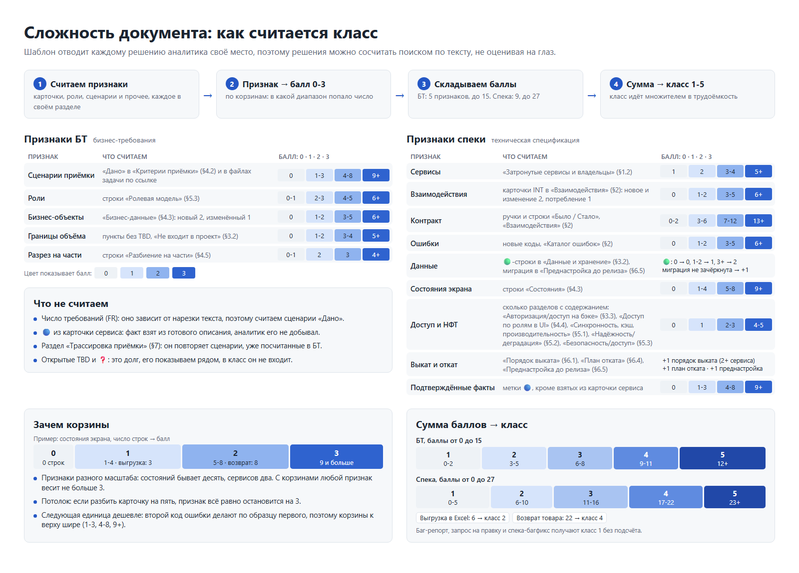

# Как мы считаем объём и сложность работы аналитика

Методика, редакция 1, 11 ноября 2026 года.

## Зачем это нужно

Аналитик пишет два основных документа: бизнес-требования (БТ) и техническую спецификацию на их основе (спеку). Чтобы планировать нагрузку, нужно понимать, сколько работы стоит за каждым из них. Часы мы не учитываем. Трудоёмкость периода считаем так: среднее количество спек за период умножаем на их сложность. Для этого нужны две величины, и у любого, кто посчитает тот же документ, они должны получиться одинаковыми:

- объём, то есть сколько написано, в листах;
- сложность, то есть сколько решений пришлось принять, классом от 1 до 5.

Одной величиной не обойтись, потому что листы в сложность не переводятся. Подробное описание одной кнопки выгрузки может занять больше листов, чем сжатая спека изменения, которое задевает три сервиса и схему данных. Бывают длинные простые документы и короткие трудные.

Вторая причина в том, как документ появляется. Текст пишет модель по ответам аналитика, и листы отчасти меряют её многословие. Сложность мы считаем по решениям, которые шаблон требует записать в определённых местах. Их модель не придумывает: за каждым стоит ответ аналитика.

Все примеры в документе учебные. Задачи и числа придуманы, чтобы показать подсчёт по шагам. Саму методику мы проверяли на двух реальных задачах, по БТ и спеке на каждую.

## Пять принципов

1. Считает скрипт. Каждое правило записано так, что его проверяет поиск по тексту, поэтому двое, посчитавшие один документ, получают одно число.
2. Считаем только то, что есть в документе. Встречи, переписка и отброшенные варианты в файл не попадают, и методика их не видит. На это ограничение мы пошли сознательно.
3. Вычитаем только служебный текст и дословные копии. Шапка у всех документов одинаковая. Диаграмма и повторный блок кода ничего нового не добавляют. Наследство эпика копируется в каждый детский БТ. Пересказ своими словами остаётся: спека повторяет часть БТ, но пересказ написан заново, и это её текст.
4. Незакрытое в работу не засчитывается. TBD и открытые вопросы в сложность не идут, их показываем отдельной строкой как долг.
5. Накрутить трудно. Можно разбить одну карточку взаимодействия на пять или расписать двадцать состояний экрана, но признак всё равно упрётся в потолок (об этом в разделе «Корзины»).

## Учебные задачи

Весь подсчёт ниже разобран на трёх задачах.

**Задача А. Выгрузка отчёта в Excel.** В системе есть отчёт о продажах. Менеджеры смотрят его на экране и переписывают цифры в свои таблицы вручную. Нужна кнопка «Скачать в Excel». Отчёт строит один сервис отчётов, новых данных не появляется. Отчёты больше 100 000 строк выгружать не даём: владелец сервиса сказал, что такой файл строится слишком долго.

**Задача Б. Возврат товара с согласованием.** Сейчас клиент звонит в поддержку, а менеджер вручную пишет на склад и в бухгалтерию. Делаем возврат через личный кабинет. Клиент оформляет заявку, менеджер её одобряет или отклоняет, кладовщик отмечает, что товар принят. После приёма платёжный сервис возвращает деньги. На каждом шаге клиенту приходит уведомление. Заявки хранятся в новом сервисе возвратов, в новых таблицах.

**Задача В. Ошибка в отчёте.** Итоговая строка отчёта о продажах не учитывает возвраты. Аналитик пишет баг-репорт, а по нему спеку в режиме «багфикс».

## Часть 1. Объём в листах

### Единица

Лист равен 1800 знакам с пробелами. Это стандартная машинописная страница, 30 строк по 60 знаков. Округляем до десятых.

Страницы распечатки не подходят: их число в PDF зависит от шрифта, полей и ширины таблиц. Длинная строка JSON или широкая таблица раздувают распечатку, хотя работы не прибавилось. Число знаков от вёрстки не зависит.

### Что считаем

Всё тело документа после первого заголовка второго уровня (`## 1. …`): абзацы, пункты списков, ячейки таблиц, блоки кода с примерами запросов и ответов. В блоках кода лишние пробелы схлопываем, иначе отступы JSON считались бы текстом.

К БТ прибавляем Markdown-файлы из папки задачи, на которые он ссылается, например вынесенные сценарии приёмки. Их считаем по тем же правилам. Файлы по ссылкам наружу (Confluence, таблицы, другие репозитории) в листы не идут. Почему так, объяснено в разделе «Признаки БТ».

### Что вычитаем и почему

Первым уходит служебный текст. Шапка документа (задача, автор, редакция, легенда меток, статус, список открытых вопросов) у всех документов одинаковая или повторяет тело. Заголовки разделов и строки-подсказки на `>` приходят из шаблона. Сюда же относятся разметка Markdown вместе с адресами ссылок, метки происхождения 🟢🔵🟡❓⚠️, строка заголовков таблицы и разделитель под ней.

Дальше голые заглушки. Так мы называем предложение, в котором, кроме служебных слов «не применимо», «TBD», «не обсуждалось», «нет» и прочерка, остаётся три слова или меньше. Например: «TBD, не обсуждалось», «Откат DDL: не применимо, миграций нет», одиночный прочерк в ячейке таблицы. Такая строка просто заполняет место, которого требует шаблон.

«Не применимо» с причиной считаем. Зачёркнутый текст тоже считаем, убираем только сами знаки `~~`. Фраза «Не применимо: выгрузка работает как обычный запрос-ответ, без очередей и фоновых задач» сообщает факт о системе, и аналитик за него отвечает. Текст режем на предложения по точке и точке с запятой, потому что в одном абзаце бывают и заглушка, и содержательная фраза.

Повторы тоже вычитаем. Схемы в коде (PlantUML, Mermaid) в нашем процессе рисует модель по тексту документа: они перерисовывают карточки взаимодействий и новых фактов не несут. Одинаковый блок кода считаем один раз: пример запроса и пример ответа нередко совпадают дословно.

И последнее: наследство эпика. В дочерних БТ блоки «Унаследовано из эпика» уже посчитаны в самом эпике. В дочерних спеках то же касается карточек `depends-on #0`, их контракт посчитан в спеке узла-фундамента. Это дословная копия, и на эпике с пятью детьми она без вычета посчиталась бы пять раз.

### Что оставляем, хотя могли бы вычесть

Пересказ БТ в спеке. Спека строится на БТ и часть его повторяет своими словами: строка «Суть» в разделе «Что делаем и тип изменения» (§1.1), раздел «Связь с бизнес-требованиями» (§1.3), тест-кейсы в разделе «Трассировка приёмки» (§7), итоговый раздел «Допущения и открытые вопросы» (§8). Всё это мы считаем. Вычесть пересказ можно двумя способами, и оба плохие. Если вырезать разделы целиком, пропадут технические подробности из тест-кейсов, которых в БТ нет. Если сравнивать текст с БТ по совпадающим словам, результат прыгает вместе с порогом совпадения. На сравнение документов между собой пересказ почти не влияет. В проверочных спеках он добавлял к каждой около листа, а отношение их объёмов сдвигалось с 1,22 до 1,19.

Можно было бы считать строже и вычитать всё, что похоже на пустое или повторное. Тогда простые документы, где много «не применимо», теряли бы больше текста и выглядели бы короче. Но простоту задачи и так показывает класс сложности, а много объёма на простых задачах видно на пересечении двух показателей (раздел «Как пользоваться»). Ловить это ещё и в листах незачем.

### Картинки и схемы

Картинки и схемы, которые человек вставил в документ, в листы не переводим. Их показываем отдельной строкой: «иллюстраций: N».

Считаем уникальные файлы png, jpg, gif, webp, svg, drawio и excalidraw в папке задачи, на которые ссылается документ. Файл, вставленный дважды, считается один раз. Ссылка наружу (Figma, Miro, Confluence) даёт 0 по той же причине, что и сценарии во внешнем файле: методика считает только то, что лежит рядом с задачей.

У цифровой картинки нет честного перевода в знаки. Её площадь зависит от разрешения: один и тот же скриншот можно сохранить на полстраницы или на три. Фиксированная цена за картинку тоже не подходит, двадцать скриншотов раздули бы объём. В класс картинки не идут, потому что решения шаблон всё равно требует записать текстом, а картинка их перерисовывает.

Строка с иллюстрациями при этом полезна. В шаблонах БТ и спеки места для картинок нет, модель их не вставляет, так что каждую добавил человек.

Схемы в коде (PlantUML, Mermaid) не идут ни в листы, ни в иллюстрации: их рисует модель. Схему, которую человек написал кодом сам, от схемы модели не отличить, поэтому она тоже не считается.

### Формула

```
знаки = сумма длин предложений, оставшихся после вычетов
листы = знаки / 1800, округлить до 0,1
```

Пример: спека задачи А (выгрузка в Excel).

| Что | Знаков |
|---|---|
| Весь файл | 8 300 (4,6 листа) |
| Шапка с легендой меток | − 1 700 |
| Заголовки, разметка, строки заголовков таблиц | − 400 |
| Голые заглушки («Откат DDL: не применимо, миграций нет», прочерки в ячейках) | − 100 |
| Остаётся | 6 100, то есть 3,4 листа |

Легенда меток одна и та же в каждой спеке и весит почти лист. Если её не вычесть, маленький документ выглядит почти на треть больше, чем есть.

## Часть 2. Сложность



### Откуда берутся признаки

Шаблоны БТ и спеки устроены так, что каждое решение аналитика записывается в определённое место и в определённой форме. Новое взаимодействие между системами оформляется отдельной карточкой `INT-N` в разделе «Взаимодействия» (§2). Код ошибки становится строкой в разделе «Каталог ошибок» (§2). Изменение данных попадает строкой с зелёной меткой в раздел «Данные и хранение» (§3.2). Сценарий приёмки начинается со слова «Дано». Поэтому решения можно сосчитать, не читая текст по смыслу.

Признаки мы отбирали по трём условиям. Признак находится поиском по тексту. За ним стоит ответ или решение аналитика, а то, что модель пишет от себя, признаком не считается. И его нельзя бесплатно увеличить, переписав документ другими словами.

### Корзины

Сырое число по признаку в сумму не идёт. Сначала его переводят в балл от 0 до 3 по тому, в какой диапазон оно попало. Такие диапазоны мы называем корзинами. У состояний экрана, например, корзины такие: 0, 1-4, 5-8, 9 и больше.

| Строк в таблице состояний | Балл |
|---|---|
| 0 | 0 |
| 3 (задача А: «файл готовится», «файл скачан», «отчёт слишком большой») | 1 |
| 8 (задача Б: от «формы заявки» до «ошибки возврата денег») | 2 |
| 12 | 3 |

Корзины нужны по трём причинам.

- Признаки бывают разного масштаба: состояний экрана набирается десяток, сервисов обычно два. Без корзин состояния перевесили бы всё остальное, а с корзинами любой признак даёт не больше 3 баллов.
- Корзина ставит потолок. Если разбить одну карточку взаимодействия на пять или расписать каждое состояние отдельной строкой, признак дойдёт до 3 и дальше не вырастет.
- Каждая следующая единица обходится дешевле. Второй код ошибки проектируют по образцу первого, десятое состояние экрана по образцу девятого. Поэтому корзины к верху расширяются, каждая примерно вдвое: 1-3, 4-8, 9 и больше.

Границы корзин мы брали так. Где у шаблона есть смысловая граница, порог взят из неё. Один сервис даёт 0 баллов, потому что согласовывать не с кем. Две части в разбиении БТ соответствуют порогу эпика из скилла бизнес-требований. Зачёркнутый пункт DDL означает, что миграции нет. Остальные пороги назначены экспертно и проверены на реальных задачах. Как перевести их на данные, сказано в разделе «Ограничения и развитие».

Два признака спеки, данные и выкат, считаются иначе: баллы набираются проверками «да / нет», не больше 3. У бизнес-объектов в БТ строки сначала взвешиваются (новый объект весит 2, изменённый 1), и уже сумма идёт в корзины. Подробности в таблицах ниже.

### Признаки БТ

| Признак | Где в документе | Что считаем | Корзины 0 / 1 / 2 / 3 |
|---|---|---|---|
| Б1. Сценарии приёмки | «Критерии приёмки» (§4.2) и файлы задачи, на которые ссылается БТ | сколько раз встречается «Дано» (в файле задачи «Дано» или Given) | 0 / 1-3 / 4-8 / 9+ |
| Б2. Роли | «Ролевая модель» (§5.3) | строки таблицы | 0-1 / 2-3 / 4-5 / 6+ |
| Б3. Бизнес-объекты | «Бизнес-данные» (§4.3) | по каждой строке: последняя колонка начинается с «нов» → 2, «без изменений» → 0, иначе 1; сумма | 0 / 1-2 / 3-5 / 6+ |
| Б4. Границы объёма | «Не входит в проект» (§3.2) | пункты без TBD | 0 / 1-2 / 3-4 / 5+ |
| Б5. Разрез на части | «Разбиение на части» (§4.5) | строки таблицы частей; «Не применимо» даёт 0 | 0-1 / 2 / 3 / 4+ |

Почему это работа аналитика:

- Б1. Каждый сценарий описывает правило поведения, которое аналитик подтвердил: основной путь, ветку или границу.
- Б2. Названия ролей и их права известны только со слов аналитика.
- Б3. Что это за объект и что в нём меняется, тоже знает только он.
- Б4. Каждое «не входит» фиксирует договорённость о рамках с заказчиком.
- Б5. Резать задачу на поставки или нет, решает аналитик.

Когда сценариев много, команда иногда выносит их в отдельный файл, а в БТ оставляет ссылку. Если это Markdown-файл в папке задачи (`coddoc/<KEY>/`), он считается частью БТ. Сценарии в нём ищутся по «Дано» и по Given (так тот же сценарий пишут по-английски), а его текст идёт в листы БТ. Ссылку наружу, на Confluence, таблицу или другой репозиторий, скрипт не открывает. Она даёт 0 баллов и 0 листов, и так задумано: методика считает только то, что лежит рядом с задачей, а положить файл в папку задачи можно за минуту. К тому же большой набор требований в одном БТ обычно значит, что перед нами эпик. Его режут на детские БТ, и в каждом свои сценарии.

Требования (FR) мы не считаем, считаем сценарии. Число FR зависит от того, как текст нарезан на пункты: одно и то же поведение можно записать тремя требованиями или восемью. В одном из проверочных БТ три требования покрывали восемь сценариев. Число сценариев от нарезки не зависит.

### Признаки спеки

| Признак | Где в документе | Что считаем | Корзины 0 / 1 / 2 / 3 |
|---|---|---|---|
| С1. Сервисы | «Затронутые сервисы и владельцы» (§1.2) | строки таблицы | 1 / 2 / 3-4 / 5+ |
| С2. Взаимодействия | «Взаимодействия» (§2), карточки `INT-N` | «новое» или «изменение существующего» → 2, «потребление» → 1, зачёркнутая карточка или `depends-on #0` → 0; сумма | 0 / 1-2 / 3-5 / 6+ |
| С3. Контракт | «Взаимодействия» (§2), вне примеров кода | разные «МЕТОД /путь» плюс строки таблиц «Было / Стало» | 0-2 / 3-6 / 7-12 / 13+ |
| С4. Ошибки | «Каталог ошибок» (§2, последний подраздел) | строки с кодом, кроме «как сейчас» и «не меняется» | 0 / 1-2 / 3-5 / 6+ |
| С5. Данные | «Данные и хранение» (§3.2), «Преднастройка до релиза» (§6.5) | строки с 🟢 в «Данные и хранение» (§3.2): 0 → 0, 1-2 → 1, 3+ → 2; плюс 1, если в «Преднастройка до релиза» (§6.5) не зачёркнут пункт «DDL-миграция» | от 0 до 3 |
| С6. Состояния экрана | «Состояния» (§4.3) | строки таблицы; если раздел зачёркнут, 0 | 0 / 1-4 / 5-8 / 9+ |
| С7. Доступ и нефункциональные требования | «Авторизация/доступ на бэке» (§3.3), «Доступ по ролям в UI» (§4.4), «Синхронность, кэш, производительность» (§5.1), «Надёжность/деградация» (§5.2), «Безопасность/доступ» (§5.3) | сколько из этих пяти разделов с содержанием | 0 / 1 / 2-3 / 4-5 |
| С8. Выкат и откат | «Порядок выката» (§6.1), «План отката» (§6.4), «Преднастройка до релиза» (§6.5) | +1, если сервисов два и больше и в «Порядок выката» (§6.1) есть содержание; +1, если в «План отката» (§6.4) есть пункт с содержанием; +1, если в «Преднастройка до релиза» (§6.5) есть незачёркнутый пункт | от 0 до 3 |
| С9. Подтверждённые факты | все разделы от «Обзор изменения» (§1) до «Трассировка приёмки» (§7), метки 🔵 | метки, у которых источник не карточка сервиса | 0 / 1-3 / 4-8 / 9+ |

Почему это работа аналитика:

- С1. У каждого следующего сервиса свой владелец, и с ним нужно согласовать стык и порядок выката.
- С2. Каждый стык требует решений о транспорте, контракте, доступе и ошибках.
- С3. По каждой ручке и каждому полю решают тип, обязательность и смысл пустого значения.
- С4. Код ошибки определяет, что увидит пользователь при сбое.
- С5. Новые данные и миграция означают вопросы к владельцу данных: что делать со старыми записями и как откатить схему.
- С6. Для каждого ответа системы нужно решить, как поведёт себя экран.
- С7. Кто вправе вызывать, где это проверяется, что с кэшем, что происходит при сбое: на каждый из этих вопросов нужен свой ответ.
- С8. Порядок выката, откат и подготовку окружения согласуют со всеми сторонами.
- С9. Метка стоит на факте о существующей системе, за который аналитик ручается сам.

В спеке мы не считаем:

- метки 🔵 со ссылкой на карточку сервиса: такой факт модель прочитала в готовом описании сервиса, и аналитику не пришлось его добывать. В проверочных спеках из карточек пришло от половины до 80 % подтверждений;
- строки раздела «Трассировка приёмки» (§7): это проекция сценариев приёмки, а сценарии уже посчитаны в БТ;
- открытые пункты: это долг, о нём ниже.

### Класс

Баллы по признакам складываем, сумму переводим в класс. Шкалы у БТ и спеки разные, потому что признаков у них разное число.

| Баллы БТ (от 0 до 15) | 0-2 | 3-5 | 6-8 | 9-11 | 12+ |
|---|---|---|---|---|---|
| Класс | 1 | 2 | 3 | 4 | 5 |

| Баллы спеки (от 0 до 27) | 0-5 | 6-10 | 11-16 | 17-22 | 23+ |
|---|---|---|---|---|---|
| Класс | 1 | 2 | 3 | 4 | 5 |

Границы для спеки поставлены с запасом сверху. Возврат товара из задачи Б (четыре сервиса, новые таблицы, четыре роли) получает класс 4. Класс 5 оставлен для задач крупнее: пять и больше сервисов, фундамент эпика, много новых стыков.

### Баг-репорт и запрос на правку

Баг-репорт, запрос на правку и спека с типом «багфикс» или «мелкая правка» в разделе «Что делаем и тип изменения» (§1.1) получают класс 1 без подсчёта. В таких документах одно короткое изменение, и признаки почти всегда нулевые. Исключение составляет запрос на правку с записью «объём выше порога, аналитик решил идти правкой». Здесь аналитик сознательно провёл крупное изменение упрощённым путём, поэтому его спеку считают по общей таблице.

### Долг

Число открытых пунктов берём из строки статуса «Требуются уточнения (N)» в шапке документа. В класс оно не входит, его показываем рядом. Документ с десятью TBD не сложнее документа без них, просто его ещё не доделали.

## Часть 3. Разбор учебных задач

### Задача А. Выгрузка отчёта в Excel

БТ: в файле 5 400 знаков (3,0 листа), после вычетов остаётся 3 800, то есть 2,1 листа.

| Признак | Что в документе | Число → балл |
|---|---|---|
| Б1. Сценарии | три «Дано»: обычная выгрузка; пустой отчёт, файл только с заголовками; отчёт больше 100 000 строк и сообщение «сузьте период» | 3 → 1 |
| Б2. Роли | одна: менеджер по продажам | 1 → 0 |
| Б3. Бизнес-объекты | «Отчёт о продажах» меняется, у него появляется выгрузка (1) | 1 → 1 |
| Б4. Границы | не входят выгрузка в PDF и рассылка отчёта по расписанию | 2 → 1 |
| Б5. Разрез | «Не применимо: одна кнопка, делить нечего» | 0 → 0 |
| Итог | | 3 балла → класс 2 |

Спека: в файле 8 300 знаков (4,6 листа), после вычетов 6 100, то есть 3,4 листа. Вычеты разобраны в части 1.

| Признак | Что в документе | Число → балл |
|---|---|---|
| С1. Сервисы | один: сервис отчётов | 1 → 0 |
| С2. Взаимодействия | одна карточка «экран отчёта → сервис отчётов», изменение существующего (2) | 2 → 1 |
| С3. Контракт | одна ручка `GET /reports/{id}` и одна строка «Было / Стало» с новым параметром `format=xlsx` | 2 → 0 |
| С4. Ошибки | один новый код: 413 «отчёт слишком большой для выгрузки» | 1 → 1 |
| С5. Данные | новых данных нет, пункт DDL зачёркнут | 0 → 0 |
| С6. Состояния экрана | «файл готовится», «файл скачан», «отчёт слишком большой» | 3 → 1 |
| С7. Доступ и НФТ | содержание есть только в «Синхронность, кэш, производительность» (§5.1): «до 100 000 строк не дольше 10 секунд»; доступ не меняется, в остальных разделах «не применимо» | 1 → 1 |
| С8. Выкат и откат | сервис один, «Порядок выката» (§6.1) не считается (0); в «План отката» (§6.4) записано «откатить версию сервиса, кнопка пропадёт» (+1); чек-лист в «Преднастройка до релиза» (§6.5) зачёркнут целиком (0) | 1 |
| С9. Подтверждённые факты | два факта со слов владельца сервиса: «отчёт строится одним запросом» и «предел 100 000 строк» | 2 → 1 |
| Итог | | 6 баллов → класс 2 |

Оба документа по задаче А получили класс 2. Изменение небольшое, но в нём есть новый код ошибки, ограничение по объёму и план отката.

### Задача Б. Возврат товара с согласованием

БТ: в файле 10 800 знаков (6,0 листа), после вычетов 8 600, то есть 4,8 листа.

| Признак | Что в документе | Число → балл |
|---|---|---|
| Б1. Сценарии | девять «Дано»: оформление; отказ после истечения 14 дней; одобрение; отклонение с причиной; приём товара; товар не тот или повреждён; деньги вернулись; платёж не прошёл; клиент отменил заявку до приёма | 9 → 3 |
| Б2. Роли | клиент, менеджер, кладовщик, бухгалтер | 4 → 2 |
| Б3. Бизнес-объекты | «Заявка на возврат», новый объект (2); «Заказ» меняется, появляется новый статус (1); «Платёж» меняется, появляется возвратный платёж (1) | 4 → 2 |
| Б4. Границы | не входят обмен товара, возврат стоимости доставки и возврат подарочных сертификатов | 3 → 2 |
| Б5. Разрез | разбиения нет, всё выходит одной поставкой | 0 → 0 |
| Итог | | 9 баллов → класс 4 |

Спека: в файле 25 700 знаков (14,3 листа), после вычетов 20 900, то есть 11,6 листа.

| Признак | Что в документе | Число → балл |
|---|---|---|
| С1. Сервисы | заказы, возвраты (новый сервис), платежи, уведомления | 4 → 2 |
| С2. Взаимодействия | шесть карточек. Три новых, по 2 балла: клиент создаёт заявку, менеджер решает, склад принимает. Одно изменение существующего (2): возвраты меняют статус заказа. Два потребления готового, по 1: возвратный платёж и отправка уведомления | 10 → 3 |
| С3. Контракт | восемь ручек (`POST /returns`, `GET /returns/{id}`, одобрить, отклонить, принять, `POST /payments/refunds`, `POST /notifications`, `PATCH /orders/{id}/status`) и две строки «Было / Стало» с новыми статусами заказа | 10 → 2 |
| С4. Ошибки | срок возврата истёк; заявка уже обработана; чужой заказ; товар не из этого заказа; платёж не прошёл | 5 → 2 |
| С5. Данные | три строки 🟢: таблица заявок, таблица позиций заявки, новый статус заказа (2); пункт DDL не зачёркнут (+1) | 3 |
| С6. Состояния экрана | форма заявки, отправлена, на согласовании, одобрена, отклонена, товар принят, деньги вернулись, ошибка возврата денег | 8 → 2 |
| С7. Доступ и НФТ | содержание в четырёх разделах: «Авторизация/доступ на бэке» (§3.3), менеджер видит заявки только своего магазина; «Доступ по ролям в UI» (§4.4), кнопки зависят от роли; «Надёжность/деградация» (§5.2), платёж повторяется при сбое; «Безопасность/доступ» (§5.3), сводка доступа. Раздел «Синхронность, кэш, производительность» (§5.1) не применим | 4 → 3 |
| С8. Выкат и откат | «Порядок выката» (§6.1): сервис возвратов с миграцией, потом заказы, потом экраны (+1); «План отката» (§6.4) заполнен (+1); «Преднастройка до релиза» (§6.5): миграция и роль «кладовщик» в сервисе доступа (+1) | 3 |
| С9. Подтверждённые факты | девять меток 🔵, три из них по карточкам сервисов. Считаются шесть, например «платёжный сервис умеет частичный возврат» со слов его владельца | 6 → 2 |
| Итог | | 22 балла → класс 4 |

В спеке остался один открытый вопрос: «что делать, если клиент вернул только часть товара из одной позиции». Это долг 1, на класс он не влияет.

### Задача В. Ошибка в отчёте

Баг-репорт занимает 1,1 листа, спека в режиме «багфикс» 1,6 листа. Признаки не считаем: у баг-репорта это следует из типа документа, у спеки из строки «Тип: багфикс» в разделе «Что делаем и тип изменения» (§1.1). Оба документа получают класс 1.

### Сводка

| Документ | Листы без вычетов | Листы | Баллы | Класс | Долг | Иллюстрации |
|---|---|---|---|---|---|---|
| БТ, задача А | 3,0 | 2,1 | 3 | 2 | 0 | 0 |
| Спека, задача А | 4,6 | 3,4 | 6 | 2 | 0 | 0 |
| БТ, задача Б | 6,0 | 4,8 | 9 | 4 | 0 | 1 |
| Спека, задача Б | 14,3 | 11,6 | 22 | 4 | 1 | 0 |
| Баг-репорт, задача В | н/д | 1,1 | по типу | 1 | 0 | 0 |
| Спека, задача В | н/д | 1,6 | по типу | 1 | 0 | 0 |

Что здесь видно:

- Спека Б длиннее спеки А в 3,4 раза, а класс у неё выше только вдвое. Шесть карточек взаимодействий описаны по одному образцу: каждая следующая прибавляет листы, а сложности всё меньше. Так и работают корзины.
- В спеке Б почти все признаки на 2 или 3, нулевых нет. Так выглядит класс 4. До класса 5 ей не хватает одного балла, например пятого сервиса.
- Баг и правку по признакам не считаем совсем, класс 1 им даёт тип документа.
- В БТ задачи Б аналитик вставил схему процесса возврата, файл `return-flow.png` из папки задачи. Это одна иллюстрация, в листы и баллы она не входит.

## Часть 4. Как пользоваться

По каждому документу получаем строку «листы · класс · долг · иллюстрации». Например: «БТ, задача Б: 4,8 листа, класс 4, долг 0, иллюстраций 1».

Трудоёмкость периода равна среднему количеству спек за период, умноженному на их сложность, то есть на класс. Классы БТ и спеки считаются по разным шкалам, и складывать их в один класс нельзя.

Листы на класс не умножаем. Листы и так растут вместе с числом карточек и разделов, и произведение посчитало бы сложность дважды.

### Пересечение листов и класса

Листы показываем только в паре с классом: сравнивать аналитиков по одним листам нельзя. Много объёма на простых задачах видно по частному, то есть по листам, делённым на класс документа.

Пример: за месяц команда сдала пять спек.

| Спека | Листы | Класс | Листы / класс |
|---|---|---|---|
| Задача А, выгрузка в Excel | 3,4 | 2 | 1,7 |
| Задача Б, возврат товара | 11,6 | 4 | 2,9 |
| Задача Г, новое поле в карточке клиента | 3,3 | 2 | 1,7 |
| Задача Д, фильтр по региону в отчёте | 4,4 | 2 | 2,2 |
| Задача Е, ещё одна выгрузка | 9,0 | 2 | 4,5 |

Медиана частного 2,2. Повод для разбора: частное больше двух медиан, то есть больше 4,4. Под правило попадает задача Е, простая выгрузка на девять листов. Спеки и БТ сравниваем отдельно. Порог назначен экспертно.

Высокое частное ещё ничего не оценивает, оно только подсказывает, какой документ открыть. За ним может стоять многословие, заполнение шаблона ради шаблона или сложность, которую признаки не уловили. Скажем, выгрузка задачи Е могла потребовать долгого согласования формата с бухгалтерией. Методика этого не увидит, это выяснится только при разборе.

## Ограничения и развитие

Методика привязана к шаблонам. Номера разделов и метки взяты из шаблона бизнес-требований версии 1.6 и шаблона спеки версии 1.8. Если шаблон изменится, таблицы признаков придётся сверить заново.

Разделы скрипт ищет по названию из шаблона, а номер служит запасным путём, так что перенумерация подсчёт не ломает. Если раздел не нашёлся, признак даёт 0, а в строке результата документа появляется пометка, например: «спека: 6,9 листа, класс 2; не найден раздел «Каталог ошибок» (§2, последний подраздел)». Пометка у одного документа обычно значит, что раздел пропустил аналитик, и 0 тогда заслуженный. Если пометка появилась сразу у всех документов, значит, шаблон изменился и скрипт пора сверить с ним. Если раздел нашёлся только по номеру, а называется иначе, пометка тоже будет: так видно, что шаблон переименовал раздел.

Пороги корзин назначены экспертно и проверены на двух реальных задачах. Чтобы периоды можно было сравнивать, пороги меняем только явным решением. Когда наберётся 20-30 реальных спек, пороги стоит перевести на данные: по каждому признаку собрать значения всех спек и поставить границы по квартилям. Нижняя четверть даёт 0 баллов, до медианы 1, до верхней четверти 2, выше 3. Тогда 3 балла будут значить «по этому признаку спека больше, чем 75 % спек команды». Часы для этого не нужны.

Методика не видит:

- сколько стоило согласование с владельцем сервиса: неделя переписки и одна реплика дают одинаковый балл;
- встречи и работу до БТ;
- отброшенные варианты решения;
- что изображено на картинке: схема процесса и случайный скриншот дают по одной иллюстрации;
- схемы, которые человек написал кодом сам: их не отличить от схем модели.

Листы складываем по документам. Сумма листов БТ и спеки одной задачи посчитает критерии приёмки дважды, потому что спека пересказывает БТ.

Накрутку корзины ограничивают, но полностью не исключают. Лишние карточки, состояния и метки поднимают признак максимум до 3 баллов. Если баллы резко выросли, а листов столько же, документ стоит посмотреть глазами.

## Приложение. Определения

- **Раздел с содержанием.** Заголовок раздела не зачёркнут, и в разделе есть хотя бы одна строка, которая не начинается с «Не применимо» (в том числе после подписи вида «Откат DDL:») и не состоит из одного прочерка.
- **Зачёркнутый.** Заголовок или пункт обёрнут в `~~…~~`. Так шаблон помечает неприменимое.
- **Источник метки 🔵.** Текст после метки до конца ячейки таблицы или до «;». Если в нём есть «карточк» или `services/`, факт взят из карточки сервиса и в С9 не идёт.
- **Предложение.** Кусок текста до точки или точки с запятой.
- **Голая заглушка.** Предложение, в котором после удаления слов «не применимо», «TBD», «не обсуждалось», «нет», прочерков, знаков препинания и цифр остаётся три слова или меньше.
- **Тело документа.** Всё после первого заголовка второго уровня.
- **Иллюстрация.** Файл картинки или схемы (png, jpg, gif, webp, svg, drawio, excalidraw) в папке задачи, на который ссылается документ. Каждый файл считается один раз.
- **Файл задачи.** Markdown-файл в папке задачи `coddoc/<KEY>/`, на который ссылается БТ. Сами БТ, спека, баг-репорт и запрос на правку файлами задачи не считаются.
